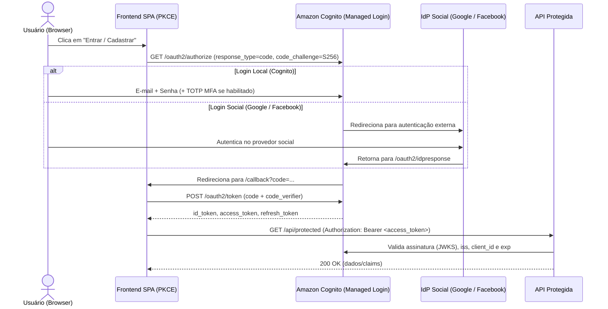

# Relatório — Tema 9: Autenticação Distribuída com Amazon Cognito

> **Atenção:** Nunca inclua `client_secret`, senhas ou tokens JWT reais completos neste relatório. Mascarar tokens nos prints e exemplos.

## 1. Arquitetura Mínima e Diagrama de Redirecionamentos

## 2. Conceitos Fundamentais

### 2.1 Tokens do Cognito e Autenticação vs. Autorização
- **ID Token (`id_token`):** Padrão OpenID Connect (OIDC). Comprova **quem é o usuário** (**autenticação**), trazendo claims de identidade como `sub`, `email`, `name` e `aud` (App Client ID).
- **Access Token (`access_token`):** Padrão OAuth 2.0. Comprova **o que o cliente pode acessar** (**autorização**) na API protegida, contendo `client_id`, `scope`, `token_use: "access"` e `exp`.
- **Refresh Token (`refresh_token`):** Usado para obter novos `id_token` e `access_token` sem exigir novo login do usuário, até expirar ou ser revogado (`/oauth2/revoke`).

### 2.2 User Pool vs. Identity Pool
- **User Pool:** Diretório de usuários e servidor OIDC/OAuth 2.0 responsável por cadastro, login, MFA, federação social e emissão de tokens JWT para autenticar usuários em aplicações e APIs (foco deste trabalho).
- **Identity Pool (Federated Identities):** Troca tokens (do User Pool ou IdPs) por credenciais temporárias da AWS (IAM/STS) para acesso direto a serviços AWS (S3, DynamoDB, etc.).

### 2.3 Logout, Sessões e Revogação
- O logout na aplicação remove os tokens locais e redireciona para `/logout` do Cognito, encerrando o cookie de sessão no domínio do Cognito.
- **Importante:** O logout no Cognito **não encerra necessariamente a sessão ativa no provedor social** (Google ou Facebook). Se o usuário permanecer logado no navegador no Google/Facebook, uma nova tentativa de login social pode autenticar automaticamente sem pedir senha novamente.
- Tokens JWT já emitidos são *stateless* e permanecem válidos até `exp` (a menos que haja revogação de refresh token via `/oauth2/revoke` ou checagem adicional).

## 3. Evidências de Implementação e Testes

### 3.1 Cadastro, Confirmação e Login (Managed Login)
- `[INSERIR PRINT: Tela de Sign-up / Confirmação por e-mail / Sign-in no Managed Login]`
- `[INSERIR PRINT: DevTools Network mostrando /oauth2/authorize e /oauth2/token]`

### 3.2 API Protegida — 3 Cenários de Teste
1. **Acesso autorizado (`200 OK` com token válido):**
   - `[INSERIR PRINT: Resposta 200 OK da rota /api/protected]`
2. **Acesso sem token (`401 Unauthorized`):**
   - `[INSERIR PRINT: Resposta 401 Unauthorized sem header Authorization]`
3. **Token expirado ou inválido (`401 Unauthorized`):**
   - `[INSERIR PRINT: Resposta 401 Unauthorized com token inválido/expirado]`

### 3.3 Logout
- `[INSERIR PRINT: Redirecionamento para /logout e estado deslogado na aplicação]`

### 3.4 Autenticação Multifator (MFA — TOTP)
- `[INSERIR PRINT: Enrolamento TOTP (sem expor segredo/QR completo)]`
- `[INSERIR PRINT: Desafio de código TOTP de 6 dígitos no login]`

### 3.5 Provedores Sociais (Google e Facebook)
- **Dependências e permissões externas:**
  - Google Cloud Console: OAuth Consent Screen + Web Client + Redirect URI `https://<dominio-cognito>/oauth2/idpresponse` (escopos `openid email profile`).
  - Meta for Developers: Facebook Login + Valid OAuth Redirect URI `https://<dominio-cognito>/oauth2/idpresponse` (permissões `public_profile`, `email`).
- **Mapeamento de atributos no Cognito:** `email → email`, `name → name`.
- `[INSERIR PRINT: Login via Google e usuário federado no User Pool]`
- `[INSERIR PRINT: Login via Facebook e usuário federado no User Pool]`

## 4. Referências
- Ganachari, G. *Secure Authentication and Authorization Frameworks for AWS Cloud Services*. Journal of AI & Cloud Computing, 2023. https://doi.org/10.47363/jaicc/2023(2)e140
- AWS. *Authenticating users with Amazon Cognito user pools*. https://docs.aws.amazon.com/cognito/latest/developerguide/cognito-user-pools.html
- AWS. *Using social identity providers with a user pool*. https://docs.aws.amazon.com/cognito/latest/developerguide/cognito-user-pools-social-idp.html
